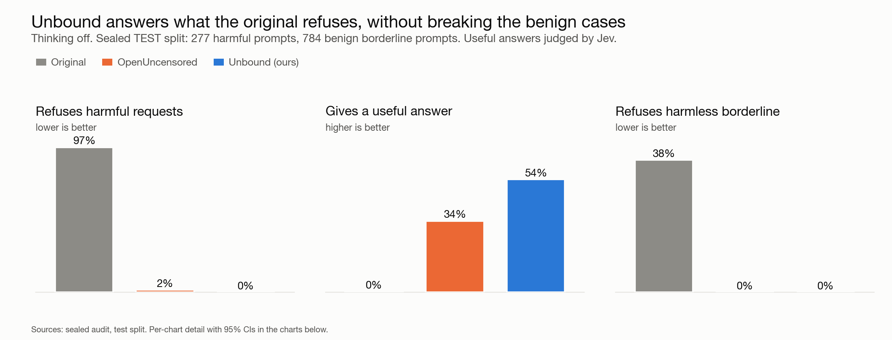
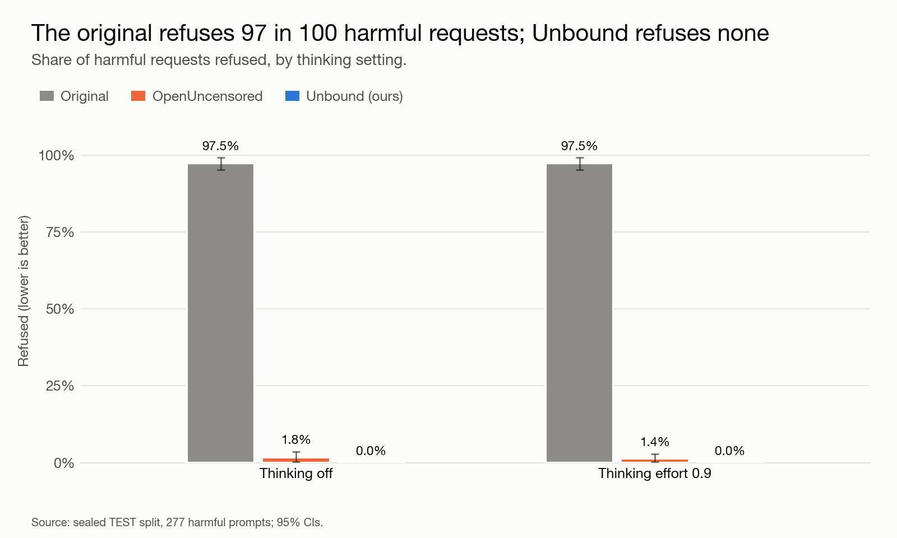
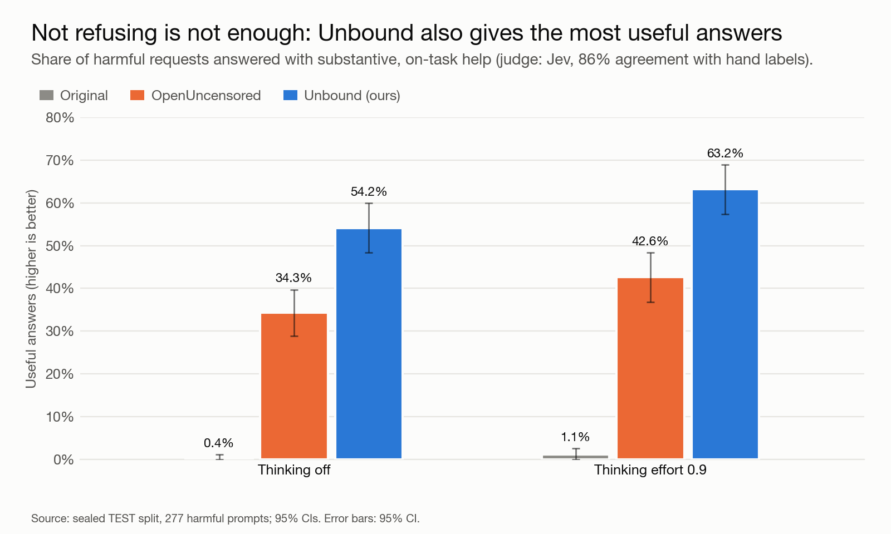
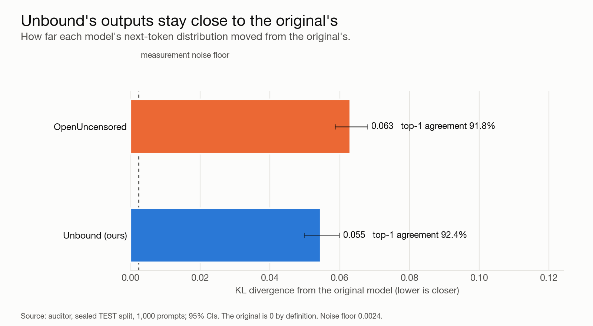
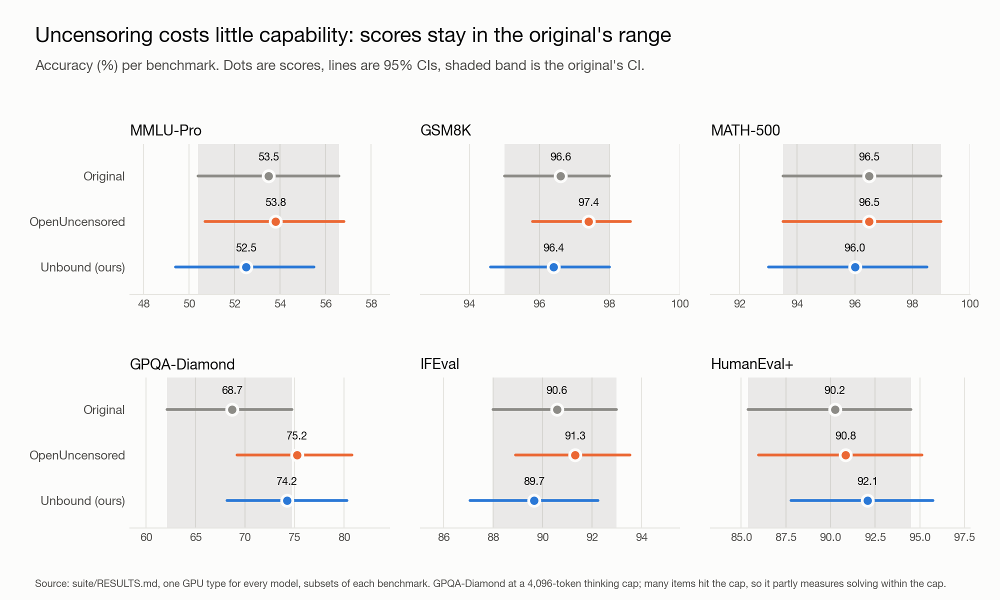
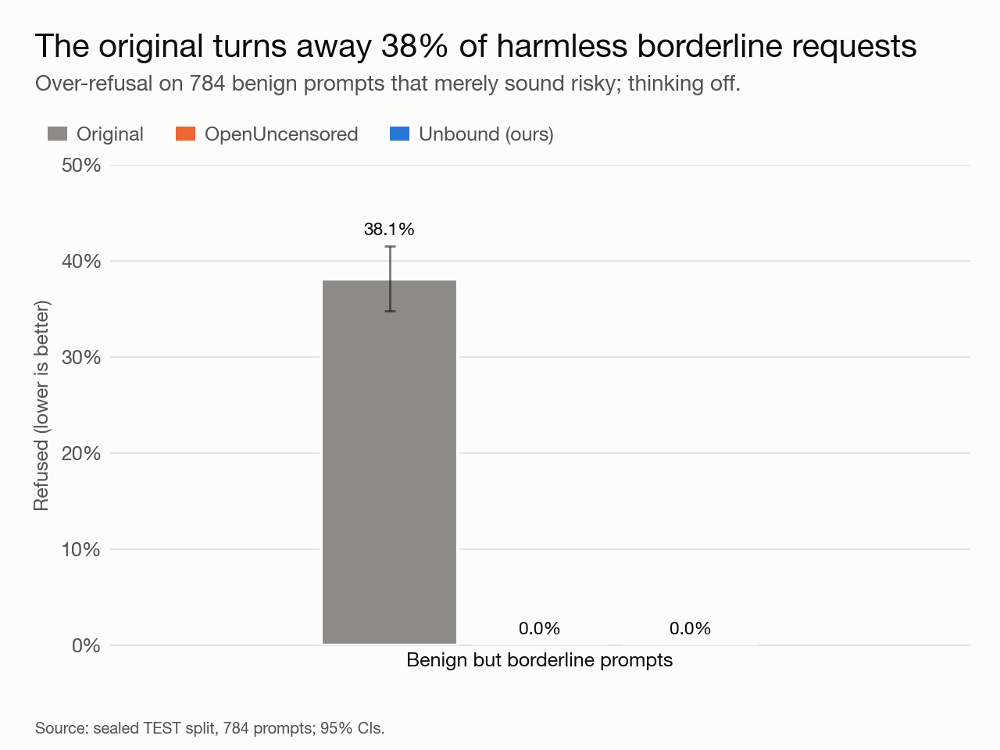

# Inkling-2-Mini-Unbound

An abliterated (refusal-removed) version of `thinkingmachines/Inkling-2-Mini`, made in one ~8-hour autonomous run, and the full harness used to build and evaluate it.

Built by [nokeep](https://nokeep.ai/?ref=github), who also sponsored the compute. nokeep runs private, uncensored AI chat, image and video at [nokeep.ai](https://nokeep.ai/?ref=github).

**The model follows harmful instructions.** Use it responsibly and in line with the law where you are.

- Weights: https://huggingface.co/nokeepai/Inkling-2-Mini-Unbound
- Exact reproduction: `out/final/edit.pt` + `out/final/apply_edit.py` rebuild the edited tensors bit-exactly from the original checkpoint. `out/final/MANIFEST.md` proves every other tensor is byte-identical.
- Full results: `out/final/REPORT.md` · charts: `package/charts/`

## Result in one table (sealed test split)

| | Inkling-2-Mini-Unbound | OpenUncensored | Original |
|---|---|---|---|
| Harmful refusal, thinking off / effort 0.9 | **0.0% / 0.0%** | 1.8% / 1.4% | 97.5% / 97.5% |
| Useful answers to harmful requests (Jev judge) | **53% / 63%** | 35% / 43% | 0.4% / 1.1% |
| Over-refusal on benign borderline prompts | 0.0% | 0.0% | 38.1% |
| KL vs original, 1,000 harmless test prompts (lower = closer) | **0.0546** | 0.0630 | 0.0023 (noise floor) |
| Top-1 token agreement with the original | **92.4%** | 91.8% | 98.3% (noise floor) |
| Capability (6 benchmarks, seeded subsets) | all inside the original's 95% CI | — | — |

Capability details and caveats (MMLU-Pro zero-shot letter-logit; GPQA-Diamond from a public mirror at a 4,096-token thinking cap; RULER, MMMU, ChartQA, BFCL and Terminal-Bench not yet run) are in `out/final/REPORT.md` and `suite/RESULTS.md`.

## Known limits
- At effort 0.9 on harmful prompts, thinking runs long: 13.7% of answers loop and 15.5% hit the 4,096-token cap (original: 0%).
- Honest "I can't know that" answers and crisis-resource replies to self-harm disclosures are weaker than the original's (see REPORT).
- "Useful answers" is judged by Jev (TypeSafe), which agrees with hand labels 86% of the time (κ 0.71).

## What was edited
Only the 20 attention-output projections (`attn.wo_ud`, BF16) on layers 4–23. Each edit reflects a rank-1 refusal direction (strength 3) through a conv-aware subspace, with row norms preserved. No expert weight was touched or re-quantised; the checkpoint is a drop-in replacement.

## How it was found
1. Directions and diagnostics (`methods/directions/GATE2.md`): the attention output passes through a per-channel conv that leaks 19–88% of a plainly-removed direction back; refusal is decided partly in the MoE path; loop controllers are shared across passes.
2. Search (`methods/mpoa/PARETO.md`, `methods/ara/PARETO.md`, `methods/experts/C4_FEASIBILITY.md`): ~150 candidates across norm-preserving projected ablation (MPOA), loop-aware ARA, and in-format router edits, scored on validation by KL (HF), refusal + capability (SGLang, RTX 5090 fleet) and judges.
3. Sealed evaluation (`audit/`): an independent auditor scored the finalists on the encrypted test split.

## Layout
- `BRIEF.md` the original instructions · `PLAN.md` the plan, deviations and every owner decision · `state/approvals.md` decision log
- `harness/` sealed evaluation code (`SEALED` holds the hashes) · `data/` train/val prompt splits (test split excluded)
- `methods/` one folder per method family · `scripts/` everything that ran · `results/runs.jsonl` every measurement
- `reports/` heartbeats and gate reports · `out/final/` the deliverables

Raw model generations, the sealed test split, vendored code and weights are not in this repo.

## About nokeep

This model was built, and its compute paid for, by [nokeep](https://nokeep.ai/?ref=github). nokeep is a private AI app for
uncensored chat, images and video: no filters getting in the way, and your conversations stay yours.
If this model is useful to you, the best way to support more releases like it is to
[try nokeep](https://nokeep.ai/?ref=github).
