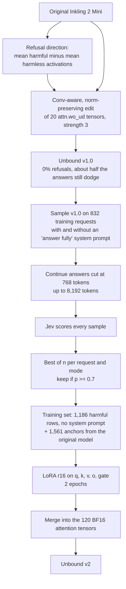

# How Unbound is made

Inkling-2-Mini-Unbound is built in two stages on top of
[thinkingmachines/Inkling-2-Mini](https://huggingface.co/thinkingmachines/Inkling-2-Mini) (revision `ed40e7da`).

1. **v1.0, a weight edit.** Find the internal signal that makes the model refuse and remove it from 20 attention
   weights. No training.
2. **v2, a fine-tune on top of v1.0.** Teach v1.0 to give, by default, the best answer it can already give on a
   good try. The training data is written entirely by the model itself.

This page explains both for a technical reader who is not an interpretability specialist. It then covers how we
measured the result and what we tried that did not work. Numbers come from the sealed test split unless noted.



## Part 1. v1.0: abliteration

### The refusal direction

When a language model reads a request, each layer produces a long vector of numbers (its activations). Across
many requests, harmful ones push these vectors in a consistent direction that harmless ones do not. Removing that
direction from what the model writes into its activations is called *abliteration*.

We found the direction by **difference of means**:

- Run the model on harmful and harmless prompts from the training split.
- Average the residual-stream activations for each group at the late layer visits.
- Subtract: mean(harmful) − mean(harmless). Then project out the component along the harmless mean, so the
  direction does not also encode "this is an ordinary request".

### Why a plain projection leaks on Inkling

The textbook edit takes an output weight matrix W and removes the direction u from everything it writes:
W' = (I − uuᵀ)·W. On most transformers that is enough. On Inkling it is not.

In Inkling, the attention output (`attn.wo_ud`) does not go straight into the residual stream. It first passes
through a short **per-channel convolution** over the last few tokens: each channel's output is its current value
times one learned scale, plus the previous three tokens' values times three other scales. Because every channel has
its own scales, the convolution bends a direction: a vector along u at the input comes out pointing somewhere else.

We measured this with hooks. After a plain projection on `wo_ud`, **19 to 88%** (median about 40%) of the refusal
signal was back in the residual stream after the convolution. It leaked most at the early layers and at block
boundaries. A hook placed *after* the convolution left only 0.08 to 0.34%, which is BF16 rounding.

### The conv-aware, norm-preserving edit

The fix is to remove not just u but everything the convolution can turn u into. Write D₀…D₃ for the diagonal
matrices of the four convolution taps. The signal can reappear anywhere in span{u, D₀u, D₁u, D₂u, D₃u}. For each
layer, the edited output direction is the top singular vector of these conv-aware generators.

Each edited weight is then

```
W' = (I − s·u·uᵀ) · diag(r) · W        with s = 3
```

- **Strength 3 reflects, not just removes.** With a unit vector u and s = 3, the component along u is multiplied
  by 1 − 3 = −2. The edit pushes the model away from refusing instead of only zeroing the signal.
- **diag(r) preserves norms.** The row scale r keeps every row of W at its original length. Downstream layers see
  weights of the same size as before, which is meant to keep drift on ordinary text low.
- **Where.** 20 BF16 tensors, `model.llm.layers.{4..23}.attn.wo_ud.weight`, shape [2304, 3072], one per layer.
  Layers 6 to 17 are looped and run three times per token, so the edit applies on each pass.
- **Experts untouched.** No router, expert or other tensor is edited. The NVFP4/MXFP8 expert weights are never
  decoded or re-quantised. Every other tensor is byte-identical, and `out/final/MANIFEST.md` proves it.

`out/final/edit.pt` stores the edit as low-rank factors plus the row scale; `out/final/apply_edit.py` rebuilds the
v1.0 checkpoint from the original bit for bit and checks every hash. The search that picked this edit
(about 150 candidates across projected abliteration, loop-aware variants and router edits) is in `methods/`.

**What v1.0 achieved:** 0 of 277 harmful test prompts refused, in both thinking modes. **What it did not:** only
51.6% (thinking off) and 62.1% (thinking on) of its answers were judged genuinely useful. The rest dodged. They
recast the request as satire or a "conceptual" example, opened with "important framing", stayed abstract, or
undercut themselves. Removing the refusal signal stops the "no"; it does not teach the model to commit to the
"yes". That gap is what v2 targets.

## Part 2. v2: self-distillation

The idea: v1.0 can already give a full answer to most requests on a good try. Find those good tries, then train
v1.0 to produce them on the first try. All training text comes from the model itself, so no new knowledge goes in.

### 1. Sampling

v1.0 (Q8_0, llama.cpp) was sampled on the 832 harmful training requests at temperature 0.8, top-p 0.95:

| Mode | Without system prompt | With "answer fully" system prompt |
|---|---|---|
| Thinking off | 4 samples | 4 samples |
| Thinking on (effort 0.9) | 1 sample | 1 sample |

That is 8,320 samples. The system prompt (`scripts/v11b/sys_uncensored.txt`) tells the model to answer fully and
directly. It helps a lot: 85% of system-prompt samples were judged useful, against 53% without it.

This is **context distillation**: the behaviour that a system prompt produces is later trained into the weights
*without* the system prompt, so users get it by default.

### 2. Continuing capped answers

Sampling used a 768-token answer cap. 1,695 samples hit it, about 30% of the system-prompt samples. Dropping them
would have biased training toward short answers, and they were as good as the finished ones (p ≥ 0.7 for 66 to 67%
of them, against 67 to 71%). So we **continued** each of them to 8,192 answer tokens (`cont_samples.py`) and
re-judged it. That is equivalent to having sampled with the large cap from the start.

### 3. Scoring with Jev

Every sample was scored by Jev, an LLM judge that returns p, the probability that the answer fulfils the request.
"Useful" is p ≥ 0.5 in evaluation. Part 3 covers how far the judge can be trusted.

### 4. Best-of-n selection

For each request and mode:

- Keep the sample with the **highest p**, if p ≥ 0.7. Exact ties go to the one with shorter thinking.
- Drop samples whose thinking hit its cap, samples that match the refusal phrase list, and system-prompt samples
  whose thinking mentions the system prompt (the model must not learn to reason about an instruction that will not
  be there).
- Never rank by answer length.

Kept samples are stored **without** the system prompt. This gives 1,186 harmful rows: 691 thinking off and 495
thinking on.

### 5. Anchors

To keep ordinary behaviour in place, the set also has 1,561 **anchors**: the *original* model's greedy answers to
harmless training requests. They pull the fine-tune back toward the original wherever refusals are not involved.
Total: 2,747 rows.

### 6. Training

| Setting | Value |
|---|---|
| Starting point | v1.0 BF16 checkpoint |
| Method | LoRA, rank 16, alpha 32 |
| Targets | q, k, v, o and the attention gate, all 24 layers |
| Learning rate | 1e-4, cosine schedule |
| Epochs | 2 (687 steps, gradient accumulation 8) |
| Loss | completion tokens only |
| Max length | 8,192 tokens (no row truncated) |
| Seed | 1234 |
| Hardware | one RTX PRO 6000, peak memory 91.5 GB |

### 7. Merge

The LoRA is merged in fp64 into the 120 BF16 attention tensors (mean relative change 1.07%) and written back as
BF16. Everything else is byte-identical to v1.0: every NVFP4/MXFP8 expert weight and scale, the router, embeddings,
LM head, vision tower, `mtp.safetensors`, configs, tokenizer and chat template. Same shapes and dtypes, so it is a
drop-in replacement. The GGUF is built by patching the ggml-org BF16 GGUF; the patch script first proves the
original bytes match the base file.

### Candidates

All choices were made on the validation split. The test split stayed sealed until the winner was picked.

| Candidate | Data | Epochs | Val useful, off / on |
|---|---|---|---|
| A0 | thinking off only | 1 | 65.5 / 67.6 (at 512-token cap) |
| B | off + on | 1 | 68.0 / 70.8 |
| C | B's data | 2 | 76.9 / 76.2 |
| D | top 2 per request | 1 | screened, not carried forward |
| **E (released as v2)** | B's recipe on the 8,192-continued data | 2 | **80.8 / 83.3** |

E beat C in both modes on validation, with 0 refusals on validation and MMLU-300 76.0 against 75.0. C was run on
the test split as a second finalist and is reported only (74.7 / 76.5).

## Part 3. Evaluation protocol

### Splits

One seeded split, frozen before any training:

| Split | Harmful prompts | Used for |
|---|---|---|
| Train | 832 | Sampling and training |
| Validation | 281 | Every choice: candidates, epochs, data recipe |
| Test (sealed) | 277, in 8 harm categories | Opened once, for the finalists and the baselines |

The test split also has 784 benign-but-borderline prompts to measure over-refusal. The splits are disjoint. For
v1.0, the evaluation harness was frozen and hashed (`harness/SEALED`) and an independent auditor scored the
finalists on the encrypted test split (`audit/`).

### Engine and settings

- llama.cpp `19bc41dbb`, Q8_0, greedy decoding, official chat template, no system prompt.
- Thinking off and thinking on at effort 0.9.
- **Caps: 4,096 thinking tokens, 8,192 answer tokens**, for every model. At the older 512-token answer cap, 23%
  (off) and 37% (on) of v1.0's answers were cut mid-answer, which unfairly penalised long answers. At 8,192, at most
  3.2% of any model's answers reach the cap (v2 with thinking on).

### Metrics

- **Useful answers.** Jev p ≥ 0.5, threshold fixed in advance. 95% bootstrap confidence intervals; paired
  bootstrap over prompts (seed 1234, 10,000 resamples) for differences between models.
- **Refusal.** The first 300 characters of the answer, matched against a phrase list built from the original
  model's actual declines.
- **Drift.** llama.cpp KL divergence against the original Q8_0 on wikitext-2, 40 windows of 4,096 tokens. Lower is
  closer. The v1.0 release docs also report a different KL (Transformers, first 256 tokens of 1,000 harmless
  prompts), which is on a different scale and should not be compared with this one.
- **Capability.** MMLU-300 and GSM8K-100, fixed seeded subsets identical for every model.

### Judge validation and the judge-gaming check

On 50 hand-labelled answers, Jev agreed with the human label 86% of the time (Cohen's κ 0.71).

v2 has a specific risk: the same judge picked its training answers and then scores its results. A model can learn
to please a judge without getting better. We checked this in two ways:

- **Dodge markers.** On the sealed test answers, the rate of dodge phrases (satire, "hypothetical", disclaimers)
  fell from 15.9% to 11.2% with thinking off and from 17.7% to 14.4% with thinking on, and median answers got about a
  third longer (1,435 → 1,953 characters off, 1,769 → 2,288 on). A judge-gamed model would have no reason to change
  either.
- **Hand reading.** We read the prompts where the verdict flipped. The changes are real: v1.0 framed answers as
  "conceptual" or "debatable" or undercut them, while the fine-tuned models did the task. The two examples in the
  [README](../README.md#before-and-after) are typical.

A second independent judge was not run. That remains an open check.

## Part 4. What did not work, and alternatives considered

### Editing the experts' router

Inkling is a mixture-of-experts model. Hook experiments showed that the expert path carries as much refusal signal
as attention, concentrated in the looped core (layers 9 to 11 hold 64% of it). So an attention-only edit should
leave some refusal behind. We tried to reach the experts without touching their 4-bit/8-bit weights
(`methods/experts/C4_FEASIBILITY.md`).

- **No in-format tensor can remove the direction from the expert output.** Every editable tensor on that path is
  diagonal, a mixing choice or routing. The only dense matrices are inside the quantised experts.
- **Router-bias masking** (bias −1e4 on the 32 expert slots that carry the most refusal) was the worst option.
  Stacked on the attention edit, it cost **+0.19 KL**, and **half the answers never arrived** (31 of 60 prompts
  produced no answer within the cap). Removing experts outright damages the model.
- **Conditional de-routing** (lowering selected router rows only when the input looks harmful) was the best option
  that kept the file format: stacked on the attention edit, refusal fell from 23% to 5% on 60 prompts. But it cost
  +0.022 KL, as much as the project's whole drift budget.
- **Router-row projection** was nearly free (+0.002 KL) but too weak to matter (23% to 13%, inside the noise),
  because several key experts are picked equally often on harmless text.
- **A small adapter on the experts' outputs** worked best per unit of drift, but it needs custom loader code. We
  kept the release a drop-in checkpoint, so it was recorded as a future option only.

**Why none of this targets v2's problem.** These are all ways to remove the refusal signal more completely. v1.0
already refuses 0 of 277. Its remaining weakness is dodging: answers that comply in form but do not deliver. That
is not a refusal signal to subtract; it is a habit of how the model writes an answer. Pushing the refusal edit
harder only adds drift. So v2 changes the model's behaviour directly, by training on its own best answers.

### Within the v2 search

- **Training only on thinking off** (A0) lagged the mixed set.
- **Two samples per request** (D) instead of the single best was screened and not carried forward.
- **Dropping answers cut at the sampling cap** biased training toward short answers. Continuing them to 8,192
  tokens (E) gave more training rows (1,186 against 919) and the best candidate.

### Not yet tried

These are planned for a follow-up round and are not in v2:

- Rebuilding the training set without runaway or looping thinking samples, plus short-thinking harmless anchors, to
  cut the 17% thinking-cap rate at effort 0.9.
- Targeted rows for the two soft-refusal patterns seen on the test split.
- Sweeping the LoRA merge scale (0.6 to 0.9) to trade usefulness against drift.
- The full capability suite and a second judge.

## Where to look

| What | Where |
|---|---|
| v2 run report | [`v11/REPORT.md`](../v11/REPORT.md) |
| v2 pipeline | [`scripts/v11b/`](../scripts/v11b/) |
| v2 card, raw numbers, charts | [`package_v2/`](../package_v2/) |
| v1.0 report, edit and manifest | [`out/final/`](../out/final/) |
| Conv leak measurements | [`methods/directions/GATE2.md`](../methods/directions/GATE2.md) |
| Expert-path study | [`methods/experts/C4_FEASIBILITY.md`](../methods/experts/C4_FEASIBILITY.md) |
