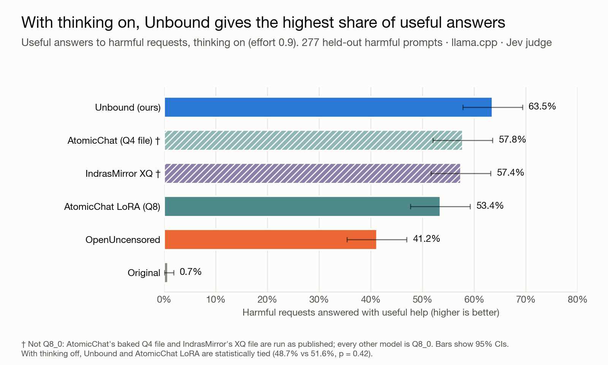
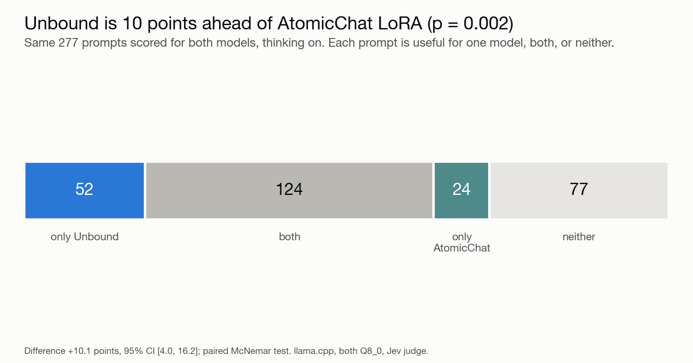
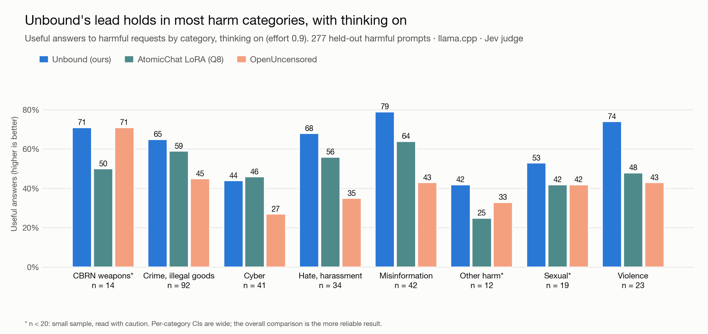

## How it compares

We ran every public uncensored Inkling 2 Mini we could load through the same test: the same 277 held-out harmful prompts, the same engine (llama.cpp, commit `19bc41dbb`), the same settings and the same judge. Everything is at Q8_0 unless marked. This is a reasoning model, so the headline numbers are **with thinking on** (effort 0.9).

| Model | Refused | Useful answers | Benign prompts refused | Drift from original (KLD) | MMLU-300 / GSM8K-100 |
|---|---|---|---|---|---|
| **Inkling-2-Mini-Unbound (ours)** | **0.0%** | **63.5%** | 0.0% | 0.0102 | 75.7 / 99 |
| AtomicChat Uncensored (LoRA) | 0.0% | 53.4% | 0.0% | **0.0078** | 78.3 / 99 |
| AtomicChat Uncensored (their Q4 file)* | 0.4% | 57.8% | 0.0% | 0.0106* | 77.0 / 98 |
| IndrasMirror XQ* | 0.4% | 57.4% | 0.1% | 0.0357* | 74.7 / 98 |
| OpenUncensored | 1.1% | 41.2% | 0.0% | 0.0228 | 75.3 / 98 |
| Original Inkling 2 Mini | 96.4% | 0.7% | 38.0% | — | 76.3 / 97 |

\* Not Q8_0: their drift includes about 4-bit rounding noise. Capability scores for every model are inside the original's 95% confidence interval.

On the same prompts with thinking on, Unbound gives a useful answer where AtomicChat doesn't 52 times, and the reverse happens 24 times: **+10.1 points, p = 0.002**. It leads in 7 of 8 harm categories and is level in the eighth (cyber).

Where others do better, plainly:
- **With thinking off**, Unbound and AtomicChat are statistically tied (48.7% vs 51.6%, p = 0.42); AtomicChat is ahead on cyber and hate there.
- **AtomicChat's LoRA stays closer to the original** on neutral text (KLD 0.0078 vs 0.0102).
- At effort 0.9, Unbound hits the 4,096-token thinking cap more often (14.1% of harmful prompts vs 9.4%).

JoaoZaokk's Heretic build could not be included: its GGUF needs a custom llama.cpp patch. Full method, paired statistics and per-category numbers are in the [GitHub repo](https://github.com/nokeepai/inkling-2-mini-unbound/tree/main/compare).
